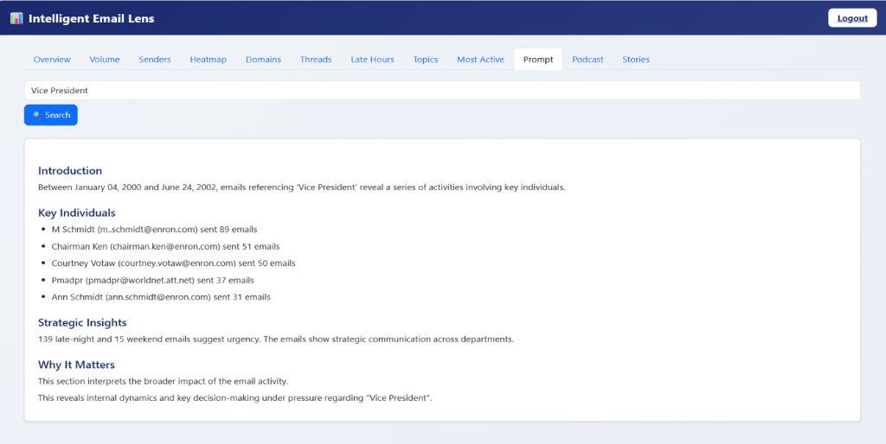
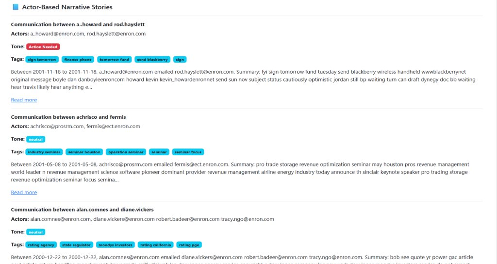
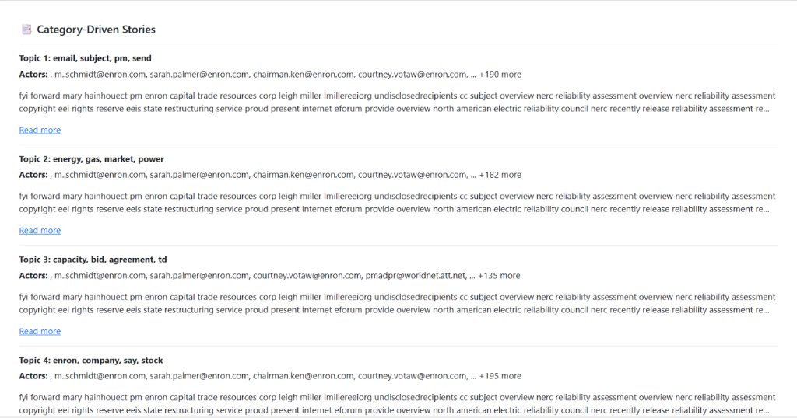
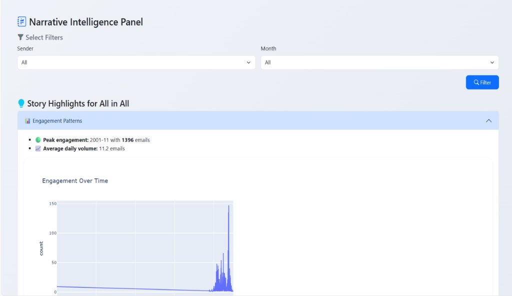
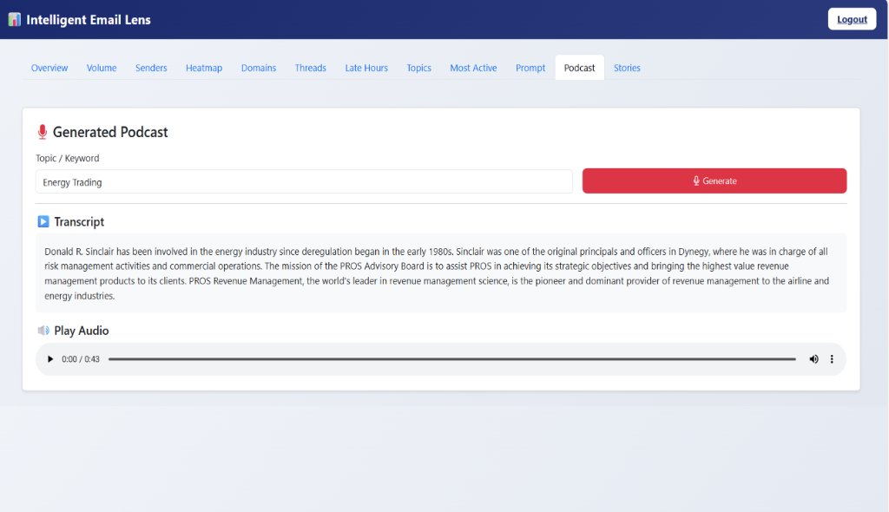

# Enron Mail Lens

An email analytics and forensic intelligence dashboard built on the historic Enron email corpus. The application ingests raw email text files, stores them in Microsoft SQL Server, processes the content using NLP pipelines, and presents insights through an interactive Flask web interface.

---

## Project Overview

Enron Mail Lens provides tools to explore, search, and analyze large collections of corporate emails:

- **Data Processing**: Parses RFC-822 formatted raw emails, extracts headers and message bodies, and applies text normalization and lemmatization.
- **Text Analytics & NLP**: Uses LDA for topic discovery, spaCy for Named Entity Recognition (NER), TextBlob for sentiment analysis, and BART transformer models for summarization.
- **Forensic & Behavioral Insights**: Identifies communication patterns such as late-night emails (12 AM – 5 AM), weekend activity, and internal versus external domain interactions.
- **Network Analysis**: Maps sender-to-recipient communication flows using directed graphs.
- **Narrative & Audio Briefs**: Generates structured narrative summaries for targeted searches and produces audio recaps via text-to-speech (gTTS).

---

## Dashboard Previews

<details>
<summary><strong>View Dashboard Screenshots (click to expand)</strong></summary>
<br>

#### Investigative Prompt Search


#### Actor-Based Stories & Tone Classification


#### Category-Driven Narrative Clusters


#### Narrative Intelligence & Engagement Trends


#### AI Podcast Generation & Audio Briefing


</details>

---

## Folder Structure

```
Enron_Mail_Lens/
├── assets/                 # Dashboard previews and screenshots
├── charts/
│   └── heatmap.py          # Heatmap generation utility
├── dbscripts/
│   └── DB.sql              # Database creation and schema script
├── RawData/                # Raw email text files (.txt)
├── static/
│   ├── css/
│   │   └── styles.css      # Custom dashboard styles
│   └── podcast.mp3         # Output file for generated audio briefs
├── templates/
│   ├── dashboard.html      # Main analytics dashboard template
│   └── login.html          # Login page template
├── utils/
│   └── db.py               # Database connection and helper functions
├── analyze.py              # Generates summaries, categories, and entity tags
├── app.py                  # Flask web application and dashboard routes
├── cleaned_emails.py       # Data cleaning and lemmatization script
├── insert_emails.py        # Ingests raw text emails into SQL Server
├── requirements.txt        # Python package dependencies
└── README.md               # Project documentation
```

---

## Prerequisites

- **Python**: 3.10 to 3.12
- **Database**: Microsoft SQL Server (2019/2022 Developer or Express)
- **ODBC Driver**: Microsoft ODBC Driver 17 for SQL Server

---

## Setup Guide

### 1. Set Up Virtual Environment

```bash
python -m venv .venv
```

Activate the environment:
- **Windows (PowerShell)**: `.\.venv\Scripts\Activate.ps1`
- **Windows (Command Prompt)**: `.\.venv\Scripts\activate.bat`
- **Linux/macOS**: `source .venv/bin/activate`

### 2. Install Dependencies

```bash
pip install -r requirements.txt
```

Download the required spaCy model and NLTK data:

```bash
python -m spacy download en_core_web_sm
python -c "import nltk; nltk.download('stopwords'); nltk.download('punkt'); nltk.download('wordnet'); nltk.download('averaged_perceptron_tagger')"
```

### 3. Initialize the Database

1. Open **SQL Server Management Studio (SSMS)**.
2. Connect to your local SQL Server instance.
3. Open and run `dbscripts/DB.sql`. This creates the `HMI` database, tables (`Users`, `Emails`, `CleanedEmails`, `AnalyzedEmails`), and initial user accounts.

### 4. Configure Database Connection

If your SQL Server instance name differs from `SKYZEN\HMI_PRO`, update the connection string in the following files:

- `utils/db.py`
- `insert_emails.py`
- `cleaned_emails.py`
- `analyze.py`
- `app.py`

Example connection string:
```python
conn = pyodbc.connect(
    'DRIVER={ODBC Driver 17 for SQL Server};'
    'SERVER=YOUR_SERVER_NAME;'
    'DATABASE=HMI;'
    'Trusted_Connection=yes;'
)
```

### 5. Ingest and Process Data

Run the pipeline scripts in sequence:

1. **Ingest Raw Emails**:
   ```bash
   python insert_emails.py
   ```
2. **Clean & Lemmatize**:
   ```bash
   python cleaned_emails.py
   ```
3. **Analyze & Tag**:
   ```bash
   python analyze.py
   ```

### 6. Run the Application

Start the Flask server:

```bash
python app.py
```

Open your browser and navigate to:
```
http://127.0.0.1:5000
```

---

## Default Login Credentials

| Username | Password | Role |
| :--- | :--- | :--- |
| `admin` | `admin` | Admin |
| `john_doe` | `123` | User |

---

## Dashboard Features

- **Overview**: High-level metrics including total emails, unique senders, date range, and daily volume trends.
- **Volume & Senders**: Monthly email volume and top sender rankings.
- **Activity Heatmap**: Day-of-week by hour-of-day email frequency distribution.
- **Domains**: Breakdown of internal (`enron.com`) vs. external domain recipients.
- **Late Hours**: Activity filters for emails sent between midnight and 5 AM.
- **Topics**: Unsupervised LDA topic clusters extracted from email subjects.
- **Prompt Search**: Free-text search that compiles narrative summaries, actor interactions, and communication sub-graphs.
- **Podcast**: Converts selected topic summaries into an audio recap using text-to-speech.
- **Stories**: Filterable chronological timeline view of conversations by sender and month.
